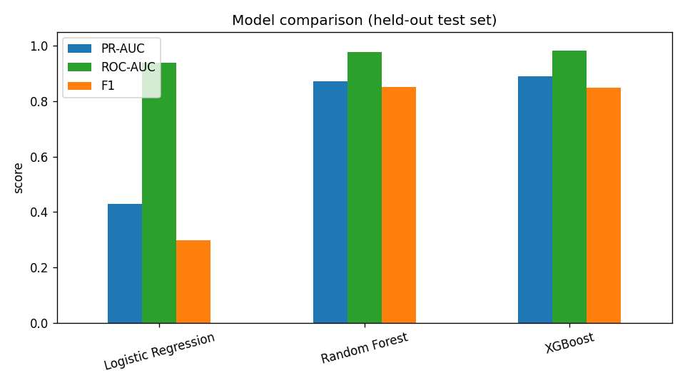
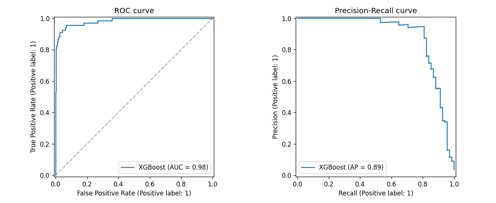
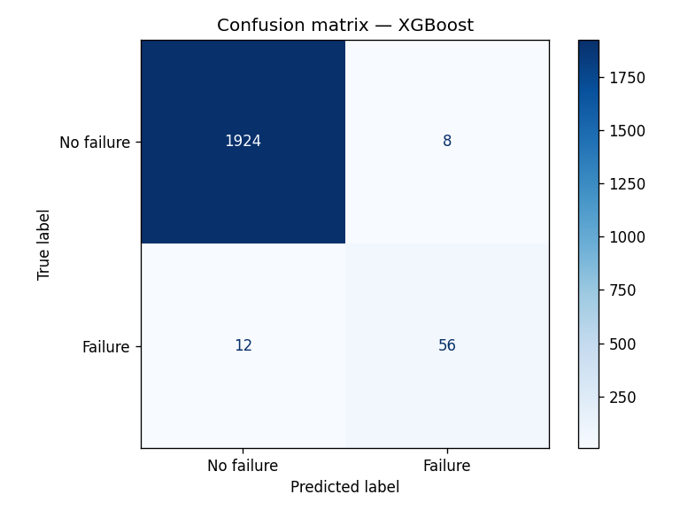
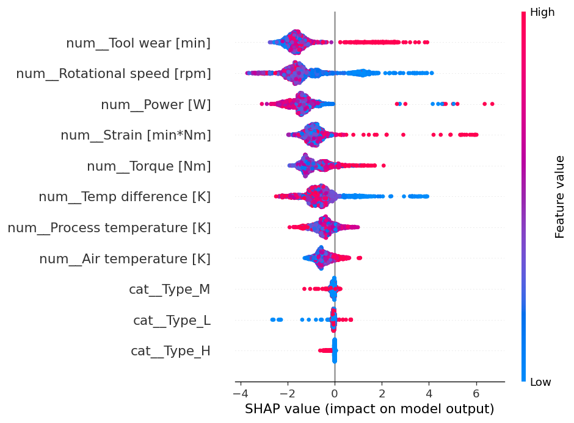

# 🛠️ Predictive Maintenance — Machine Failure Prediction


Predict whether an industrial machine is about to **fail** from its live sensor readings, so maintenance can be scheduled **before** a breakdown — cutting unplanned downtime and cost. End-to-end project: data → feature engineering → modelling → explainability → a deployed interactive app.

> **Result:** an XGBoost model that detects **82% of real failures** with **87.5% precision** (PR-AUC **0.89**, ROC-AUC **0.98**) on held-out data.

---

## 🎯 Problem

In manufacturing, unplanned machine failures are expensive. **Predictive maintenance** uses sensor data to flag machines likely to fail soon, turning reactive repairs into planned interventions. This is an **imbalanced binary classification** problem (failures are rare ~3.4%), so the project is evaluated with **PR-AUC and recall**, not accuracy.

## 📊 Dataset

[UCI AI4I 2020 Predictive Maintenance dataset](https://archive.ics.uci.edu/dataset/601/ai4i+2020+predictive+maintenance+dataset) — **10,000** records of a milling machine.

| Feature | Description |
| --- | --- |
| Type | Product quality variant (L / M / H) |
| Air temperature [K] | Ambient temperature |
| Process temperature [K] | Process temperature |
| Rotational speed [rpm] | Spindle speed |
| Torque [Nm] | Applied torque |
| Tool wear [min] | Cumulative tool wear |
| **Machine failure** | Target (0/1) |

**Engineered features** (physics-informed, in `src/data.py`): temperature difference, mechanical **power** (torque × angular velocity), and **strain** (tool wear × torque).

## 🔬 Approach

1. **EDA** — class imbalance, failure modes, sensor distributions, correlations ([`notebooks/01_eda.ipynb`](notebooks/01_eda.ipynb)).
2. **Preprocessing** — scaling + one-hot encoding in an sklearn `Pipeline` (no leakage).
3. **Models** — Logistic Regression, Random Forest, XGBoost, all with class-imbalance handling.
4. **Evaluation** — 5-fold stratified CV + held-out test set, scored with PR-AUC / ROC-AUC / F1.
5. **Explainability** — SHAP (global + per-prediction).
6. **Deployment** — a Streamlit app for live what-if predictions.

## 🏆 Results (held-out test set, 2,000 machines)

| Model | PR-AUC | ROC-AUC | F1 (failure) |
| --- | --- | --- | --- |
| Logistic Regression | 0.430 | 0.939 | 0.298 |
| Random Forest | 0.872 | 0.978 | 0.852 |
| **XGBoost** ⭐ | **0.890** | **0.984** | **0.848** |

The best model catches **56 of 68** real failures (recall 0.82) while raising only **8 false alarms** out of 1,932 healthy machines (precision 0.875).

| Model comparison | ROC & PR curves |
| --- | --- |
|  |  |

| Confusion matrix | Feature importance (SHAP) |
| --- | --- |
|  |  |

## 🚀 The app

An interactive **Streamlit** app: move the sensor sliders to get a live failure probability, a risk gauge, and a **SHAP explanation** of which factors drove the prediction.

```bash
streamlit run app.py
```

## 🗂️ Project structure

```
predictive-maintenance/
├── app.py                  # Streamlit app (live prediction + SHAP explanation)
├── src/
│   ├── data.py             # data loading + feature engineering (shared)
│   ├── download_data.py    # fetch the dataset from UCI
│   └── train.py            # train/compare models, save best + figures
├── notebooks/
│   └── 01_eda.ipynb        # exploratory data analysis
├── models/model.joblib     # trained pipeline
├── reports/                # metrics.json + evaluation figures
├── data/ai4i2020.csv       # dataset
├── requirements.txt
└── README.md
```

## ⚙️ Run it yourself

```bash
git clone https://github.com/elayeboussama/predictive-maintenance.git
cd predictive-maintenance
pip install -r requirements.txt

# dataset is included; to re-download:  python src/download_data.py
python src/train.py        # (optional) retrain and regenerate figures
streamlit run app.py       # launch the app
```

## 🧰 Tech stack

Python · pandas · scikit-learn · XGBoost · SHAP · Streamlit · Plotly · Matplotlib / Seaborn

## 👤 Author

**Oussama Elayeb** — [@elayeboussama](https://github.com/elayeboussama)

## 📄 License

MIT — see [LICENSE](LICENSE).
